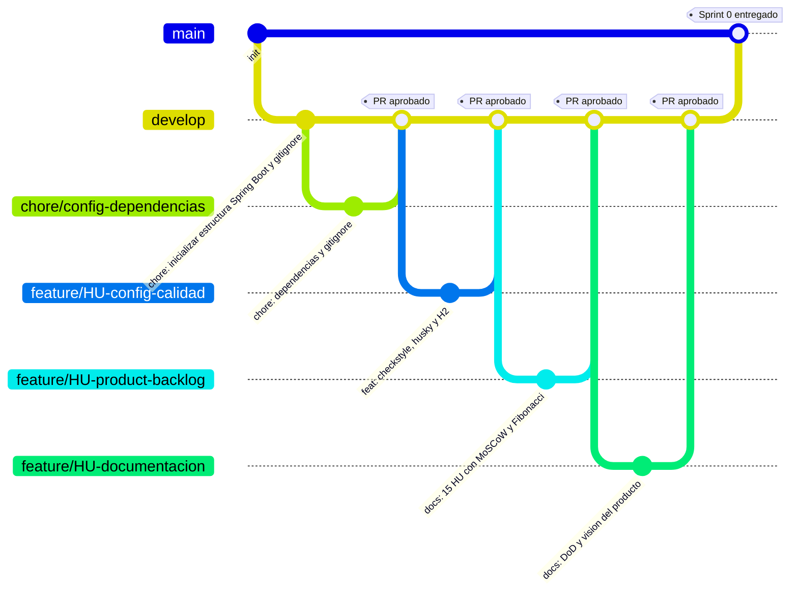

# AgroValle Connect


**Contexto Técnico:** Asignatura Ingeniería de Software II - UNIAJC

## 1. Declaración de la Visión del Producto

>**Para** los productores agrícolas del Valle del Cauca,
**Que** necesitan vender directo a sus compradores sin intermediarios excesivos,
>**AgroValle Connect** es una plataforma web desarrollada en Java / Spring Boot,
**Que** conecta la oferta y la demanda agrícola regional a precio justo,
>**A diferencia de** los intermediarios tradicionales de la cadena de comercialización,
**Nuestro producto** garantiza trazabilidad del pedido y contratos de API transparentes entre agricultores, comerciantes y transportistas.

El sistema busca resolver tres problemas estructurales: la intermediación excesiva que castiga el precio al productor, la falta de visibilidad en tiempo real de la oferta agrícola, y la ausencia de trazabilidad y coordinación logística en los despachos poscosecha.

## 2. Equipo

| Integrante | Rol |
|---|---|
| _Josen Julian Mina Carabali_ | Scrum Master |
| _Josue Mindineros Castillo_  | Backend / DevOps |
| _Lesly Camila Quintero Popo_ | Product Owner |
| _Yenni Liseth Obando Obando_ | QA / Documentador |

## Alcance del producto

El [Product Backlog](docs/requirements/product-backlog-bdd.md) reúne 15 historias y 58 puntos estimados con Fibonacci: 10 historias Must, 4 Should y 1 Could. El trabajo documentado hasta el Sprint 3 cubre registro de agricultores, publicación y búsqueda de productos, contacto, pedidos, pagos simulados, cancelación, asignación de vehículo y consulta de rutas. Render ejecuta el backend de staging y Neon aloja PostgreSQL.

## 3. Estrategia de Ramas: GitFlow

### Justificación de GitFlow

El equipo eligió **GitFlow** porque el proyecto tiene entregas por sprint claramente delimitadas (evaluaciones del curso), lo que encaja con la separación que GitFlow hace entre una rama estable (`main`), una rama de integración continua del trabajo del equipo (`develop`) y ramas de vida corta para cada historia de usuario (`feature/*`). Esto minimiza los tiempos de espera y previene conflictos de fusión extensos porque:

- `main` siempre queda desplegable y corresponde exactamente a lo evaluado en cada sprint, evitando que código a medio terminar llegue a la entrega oficial.
- El trabajo de los 4 integrantes se integra en `develop` de forma incremental
- Cada Historia de Usuario queda aislada en su propia rama de vida corta, revisada por pares vía Pull Request antes de fusionarse

### Diagrama de la estrategia de ramas



### Convención de ramas

- `main`: código estable, correspondiente a cada entrega evaluada.
- `develop`: integración del trabajo de todo el equipo.
- `feature/HU0X-descripcion-corta`: una rama por Historia de Usuario 

### Convención de commits

- `feat:` nueva caracteristica
- `fix:` corrección de errores
- `docs:` cambios en la documentación
- `test:` agregar o corregir pruebas
- `chore:` tareas de mantenimiento
- `refactor:` refactorización de código sin cambiar la funcionalidad

## 4. Stack técnico

- Java 17 — lenguaje de programación principal del backend
- Spring Boot 4.1.1 — framework que facilita la creación de aplicaciones web.
- Spring Security + JWT — las contraseñas se protegen con hashes BCrypt, nunca en texto plano.
- PostgreSQL — sistema de base de datos relacional (persistencia real); H2 en memoria para las pruebas automatizadas.
- Maven — herramienta de gestión de dependencias.
- JUnit 5 + Mockito — framework para escribir y ejecutar pruebas unitarias sobre la lógica de negocio.
- JaCoCo — herramienta que mide el porcentaje de cobertura de código cubierto por las pruebas unitarias (mínimo 60 % exigido por el pipeline).
- Checkstyle — herramienta de análisis estático que verifica que el código cumpla las reglas de estilo definidas


## 5. Cómo contribuir (flujo local)

```bash
git checkout develop
git pull origin develop
git checkout -b feature/HU0X-descripcion-corta
# ... trabajar y hacer commits semánticos ...
git push origin feature/HU0X-descripcion-corta
# Abrir Pull Request hacia develop, asignar 1-2 revisores, esperar aprobación
```

## 6. Guía rápida de desarrollo

Requisitos: Git, JDK 17 y PostgreSQL local. El proyecto incluye Maven Wrapper. En PowerShell:

```powershell
git clone https://github.com/JulianM8/agrovalle-connect.git
cd agrovalle-connect
.\mvnw.cmd clean verify
```

La verificación ejecuta pruebas con H2, Checkstyle y la comprobación de cobertura JaCoCo. Para levantar la API con el perfil local, crea la base `agrovalle_connect` en PostgreSQL, accesible en `localhost:5432` con el usuario `postgres`. Configura en la sesión `DB_PASSWORD` con la contraseña local y `JWT_SECRET` con una clave aleatoria de al menos 32 bytes. Luego ejecuta:

```powershell
.\mvnw.cmd spring-boot:run
```

Comprueba el servicio en `http://localhost:8080/api/v1/estado`. En Linux/macOS usa `./mvnw` en los mismos comandos.

## 7. Mapa de documentación

| Tema | Documento |
|---|---|
| Historias, prioridades y estimaciones | [Product backlog](docs/requirements/product-backlog-bdd.md) |
| Contrato de calidad | [Definition of Done](docs/dod.md) |
| Requerimientos formales | [Especificación IEEE 29148](docs/requirements/ieee29148-req01.md) |
| Sprint de diseño, UML y modelos de datos | [Diseño](docs/diseno/architecture) |
| Despliegue en staging | [ADR-001](docs/architecture-decisions/ADR-001-despliegue-staging-paas.md) |
| Reviews | [Sprint 1](docs/sprints/sprint-1/review.md) · [Sprint 2](docs/sprints/sprint-2/review.md) · [Sprint 3](docs/sprints/sprint-3/review.md) · [Sprint 4](docs/sprints/sprint-4/review.md) |
| Seguimiento diario | [Bitácora Scrum](docs/bitacora-daily-scrum.md) |
| Métricas del tercer corte | [Métricas](docs/metrics/sprint-metrics-corte3.md) |
| Verificación y despliegue | [GitHub Actions](https://github.com/JulianM8/agrovalle-connect/actions) |