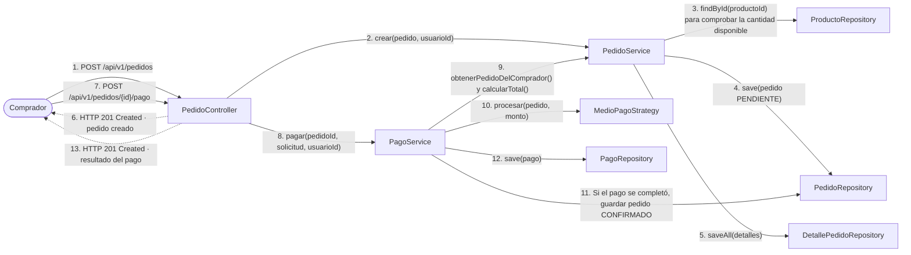
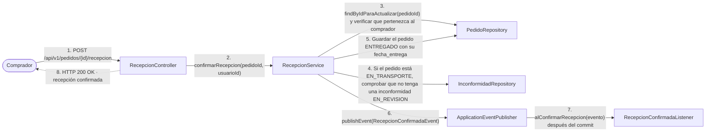
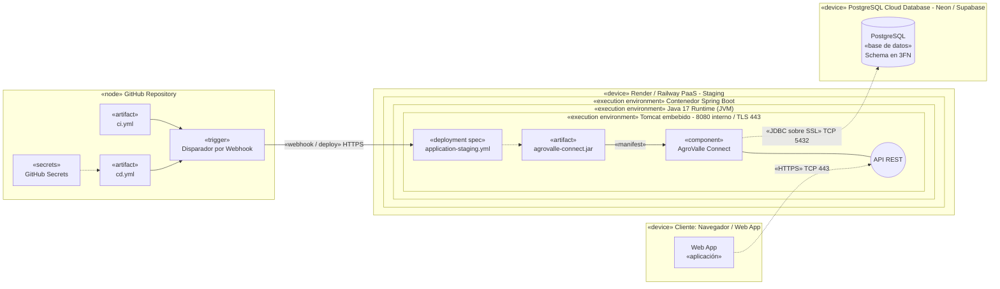
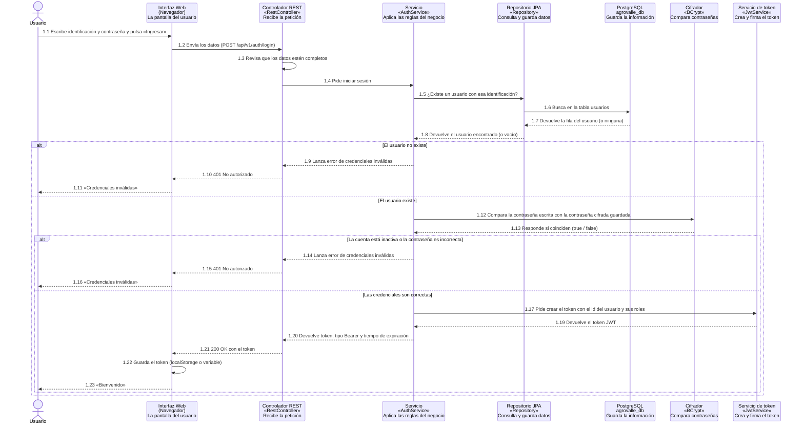
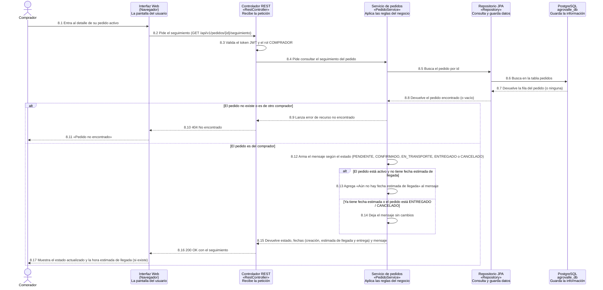
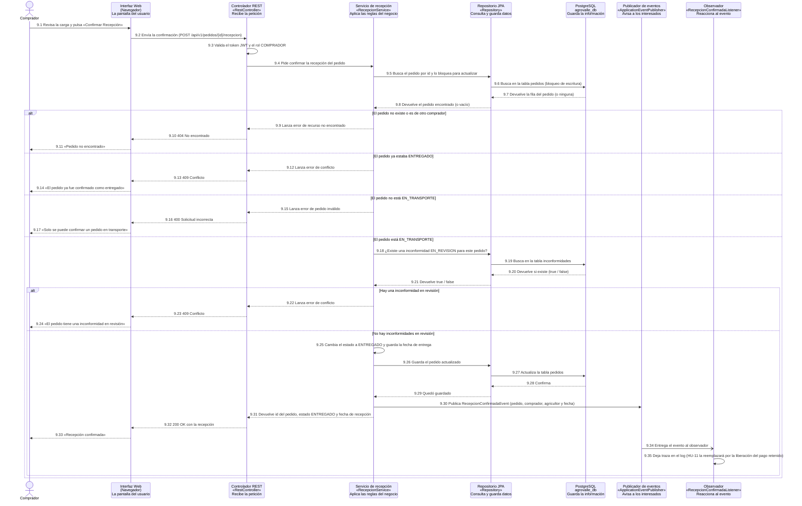
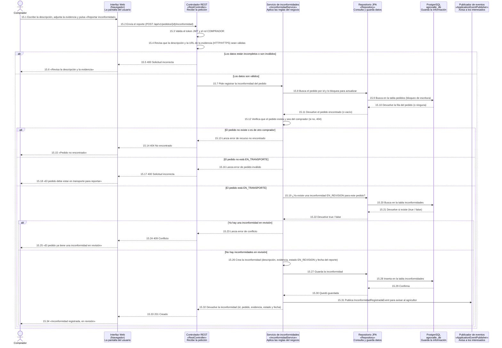

## Diagramas de colaboración

### Colaboración 1 · Confirmación del pedido y validación de inventario (HU-10)

### Colaboración 2 · Despacho y publicación del evento de asignación (HU-06)

### Colaboración 3 · Confirmación de recepción y publicación del evento (HU-09)

## Diagrama de despliegue V2

## Diagramas de secuencia

### Login y generacion del token

### HU-08: Seguimiento del envío

### HU-09: Confirmación de recepción de la mercancía

### HU-15: Reporte de inconformidad o producto dañado

