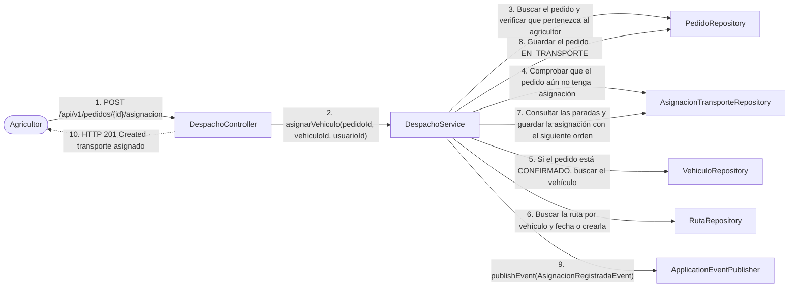
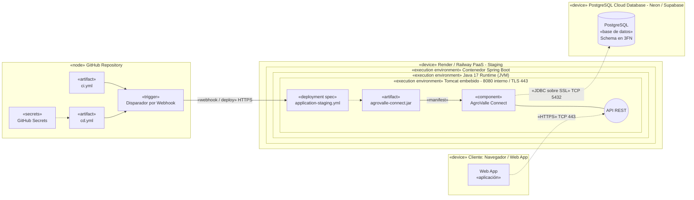

## Diagramas de colaboración

### Colaboración 1 · Confirmación del pedido y validación de inventario (HU-10)

### Colaboración 2 · Despacho y publicación del evento de asignación (HU-06)

## Diagrama de despliegue V2

