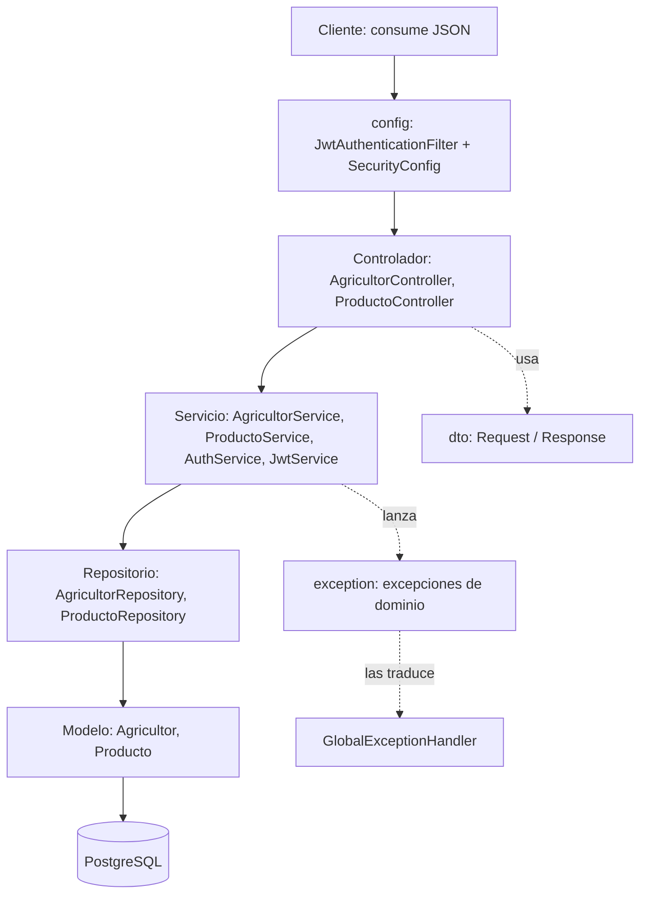
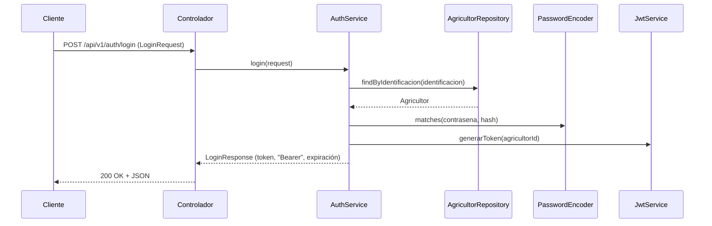
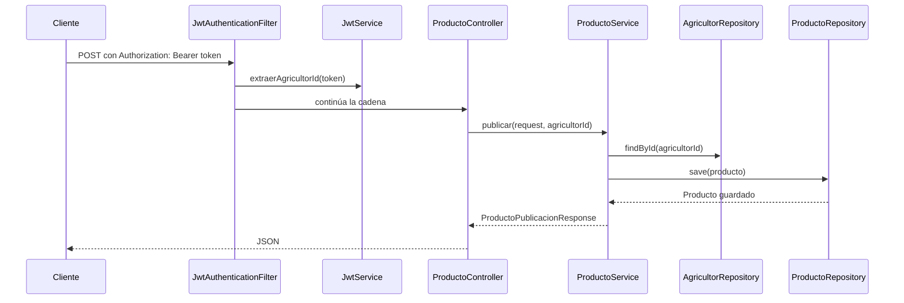

# Arquitectura MVC en 4 Capas y Patrones GoF / Enterprise — AgroValle Connect

## 1. Introducción y alcance

AgroValle Connect es una API REST que conecta a los agricultores del Valle del Cauca con compradores de productos agrícolas. Este documento describe la arquitectura del backend, organizada en **cuatro capas** siguiendo el patrón MVC adaptado a una API REST con Spring Boot, y especifica los **patrones de diseño GoF y Enterprise** aplicados en el código fuente.

El documento cubre el código implementado hasta el momento (registro y autenticación de agricultores, publicación de productos y filtrado del catálogo; HU-01, HU-02 y HU-04) y señala cómo la arquitectura soporta las 15 historias de usuario del backlog.

**Stack tecnológico**

| Elemento | Tecnología |
|---|---|
| Lenguaje / JVM | Java 17 LTS |
| Framework | Spring Boot (Web, Data JPA, Security, Validation) |
| Persistencia | PostgreSQL + Hibernate/JPA |
| Seguridad | Spring Security, JWT (jjwt), BCrypt |
| Pruebas | JUnit 5 |
| Calidad | Checkstyle (línea máx. 120 caracteres) |

---

## 2. Arquitectura MVC en 4 capas

### 2.1. Diagrama de capas

En una API REST no existe una vista HTML: la **Vista** es la representación JSON de los **DTO** que se devuelven al cliente. El **Controlador** recibe la petición HTTP, el **Modelo** se divide en lógica de dominio (servicios) y acceso a datos (repositorios + entidades), y una cuarta capa física almacena los datos en PostgreSQL.



### 2.2. Estructura de capas

Código base: `src/main/java/com/agrovalle/connect/`

| Capa | Responsabilidad | Paquete | Clases |
|---|---|---|---|
| **Vista** | Representación de los datos que ve el cliente. Al ser una API REST, la vista es el contrato JSON definido por los DTOs de respuesta | `dto` | `ProductoConsultaResponse`, `ProductoFiltroResponse`, `ProductoPublicacionResponse`, `LoginResponse` |
| **Controlador** | Recibe la petición HTTP, entrega los datos al servicio y devuelve la respuesta | `controller` | `AgricultorController`, `ProductoController` |
| **Servicio** | Reglas de negocio y casos de uso | `service` | `AgricultorService`, `ProductoService`, `AuthService`, `JwtService` |
| **Modelo / Persistencia** | Entidades del dominio y acceso a PostgreSQL | `model`, `repository` | `Agricultor`, `Producto`, `AgricultorRepository`, `ProductoRepository` |

### Componentes transversales (no son una capa)

| Paquete | Contenido | Función |
|---|---|---|
| `config` | `SecurityConfig`, `JwtAuthenticationFilter` | Seguridad: JWT, sesiones stateless, rutas públicas y protegidas |
| `dto` | `LoginRequest`, `ProductoPublicacionRequest`, registros de agricultor, etc. | Objetos de transferencia entre cliente y controlador |
| `exception` | `AgricultorNoEncontradoException`, `CredencialesInvalidasException`, `FechaCosechaInvalidaException`, `IdentificacionDuplicada...`, `GlobalExceptionHandler` | Errores de dominio y su traducción a respuestas HTTP |

### Reglas de dependencia

- El flujo es **Controlador → Servicio → Repositorio → Base de datos**.
- El controlador no accede a los repositorios.
- El servicio no conoce HTTP: recibe DTOs y lanza excepciones de dominio.
- Las dependencias se reciben **por constructor** (inyección de dependencias de Spring).

## 3. Flujos de ejecución

### 3.1 Inicio de sesión



Si el agricultor no existe o la contraseña no coincide, `AuthService` lanza
`CredencialesInvalidasException`. Se usa la misma excepción en ambos casos para
no revelar cuál de los dos datos falló.

### 3.2 Publicación de un producto



Reglas de negocio aplicadas en `ProductoService.publicar`:

- el agricultor debe existir (`AgricultorNoEncontradoException`);
- la fecha de cosecha no puede ser anterior a hoy (`FechaCosechaInvalidaException`).

La consulta del catálogo (`buscarDisponiblesPorMunicipioYCategoria`) solo
devuelve productos con `cantidad > 0`.

## 4. Patrones GoF

| Patrón | Categoría | Archivos | Propósito |
|---|---|---|---|
| Builder | Creacional | `JwtService`, `SecurityConfig` | Armar paso a paso el token JWT y la cadena de seguridad |
| Chain of Responsibility | Comportamiento | `JwtAuthenticationFilter`, `SecurityConfig` | Autenticar cada petición en un eslabón de la cadena de filtros |
| Strategy | Comportamiento | `SecurityConfig`, `AuthService` | Algoritmo de hash de contraseñas intercambiable |

---

### 4.1 Builder (Creacional)

- **Problema:** un token JWT y la cadena de seguridad tienen muchos pasos de
  configuración opcionales. Un constructor con todos los parámetros sería
  ilegible y rígido.
- **Dónde está:**
  - `service/JwtService.java`: `generarToken(...)` con `Jwts.builder()` y
    `extraerAgricultorId(...)` con `Jwts.parser()...build()`
  - `config/SecurityConfig.java`: `filterChain(...)` con `http...build()`
- **Participantes:**

  | | Generar token | Validar token | Seguridad HTTP |
  |---|---|---|---|
  | Builder | `JwtBuilder` (JJWT) | `JwtParserBuilder` (JJWT) | `HttpSecurity` (Spring) |
  | Producto | token JWT (`String`) | `JwtParser` | `SecurityFilterChain` |
  | Director | `JwtService` | `JwtService` | `SecurityConfig` |

- **Cómo funciona aquí:** `JwtService` arma el token paso a paso (sujeto = id
  del agricultor, fecha de emisión, expiración y firma con la clave HMAC) y
  cierra con `compact()`. De forma análoga, `SecurityConfig` encadena las
  reglas de seguridad y cierra con `build()`.
- **Beneficio:** construcción legible paso a paso; se pueden añadir claims o
  reglas sin cambiar firmas de métodos.

```java
// JwtService.generarToken
return Jwts.builder()
    .subject(agricultorId.toString())
    .issuedAt(ahora)
    .expiration(expiracion)
    .signWith(clave)
    .compact();
```

---

### 4.2 Chain of Responsibility (Comportamiento)

- **Problema:** autenticar cada petición sin mezclar esa lógica con los
  controladores ni con los servicios.
- **Dónde está:** `config/JwtAuthenticationFilter.java`, registrado en
  `config/SecurityConfig.java` con `addFilterBefore(...)`.
- **Participantes:**

  | Rol | Clase |
  |---|---|
  | Handler | `Filter` / `OncePerRequestFilter` (Jakarta Servlet / Spring) |
  | ConcreteHandler | `JwtAuthenticationFilter` |
  | Client | `SecurityFilterChain` (arma y recorre la cadena) |

- **Cómo funciona aquí:** el filtro lee el encabezado `Authorization: Bearer ...`,
  extrae el `agricultorId` con `JwtService` y, si el token es válido, guarda la
  autenticación en el `SecurityContextHolder`. Si falla, limpia el contexto. En
  ambos casos llama a `filterChain.doFilter(...)` para pasar la petición al
  siguiente eslabón. El rechazo final lo decide `authorizeHttpRequests`
  (`anyRequest().authenticated()`).
- **Beneficio:** la autenticación queda desacoplada de los controladores y se
  pueden añadir o reordenar filtros sin modificar el resto del sistema.
- **Decisión de diseño:** el filtro se instancia con `new` dentro de
  `SecurityConfig` y no lleva `@Component`, para que Spring Boot no lo registre
  dos veces como filtro de servlet.

```java
// JwtAuthenticationFilter.doFilterInternal
String header = request.getHeader("Authorization");
if (header != null && header.startsWith("Bearer ")) {
  String token = header.substring(7);
  try {
    Long agricultorId = jwtService.extraerAgricultorId(token);
    var authentication = new UsernamePasswordAuthenticationToken(
        agricultorId, null, List.of());
    SecurityContextHolder.getContext().setAuthentication(authentication);
  } catch (Exception ex) {
    SecurityContextHolder.clearContext();
  }
}
filterChain.doFilter(request, response);
```

---

### 4.3 Strategy (Comportamiento)

- **Problema:** la verificación de contraseñas depende de un algoritmo de hash
  que puede cambiar (BCrypt, Argon2, etc.) y no debe afectar a la lógica de
  inicio de sesión.
- **Dónde está:**
  - Selección de la estrategia: `config/SecurityConfig.java`, método `passwordEncoder()`
  - Uso: `service/AuthService.java`, método `login(...)`
- **Participantes:**

  | Rol | Clase |
  |---|---|
  | Strategy | `PasswordEncoder` (Spring Security) |
  | ConcreteStrategy | `BCryptPasswordEncoder` |
  | Context | `AuthService` |

- **Cómo funciona aquí:** `SecurityConfig` registra un `BCryptPasswordEncoder`
  como bean de tipo `PasswordEncoder`. `AuthService` lo recibe por constructor
  y llama a `matches(...)` para validar la contraseña del agricultor.
- **Beneficio:** se puede cambiar el algoritmo de hash modificando una sola
  línea de `SecurityConfig`, sin tocar `AuthService` (principio abierto/cerrado).

```java
// SecurityConfig
@Bean
public PasswordEncoder passwordEncoder() {
  return new BCryptPasswordEncoder();
}

// AuthService.login
if (!passwordEncoder.matches(request.contrasena(), agricultor.getContrasena())) {
  throw new CredencialesInvalidasException();
}
```

## 5. Otros patrones y principios (no GoF)

Estos patrones también están presentes, pero no pertenecen al catálogo GoF.

### Service Layer

- **Dónde está:** `service/ProductoService.java`, `AuthService.java`,
  `AgricultorService.java`.
- **Responsabilidad:** concentrar las reglas de negocio y orquestar los
  repositorios, sin conocer HTTP ni SQL.
- **Ejemplo:** `ProductoService.publicar` valida que el agricultor exista y que
  la fecha de cosecha no sea anterior a hoy antes de guardar.

### Repository

- **Dónde está:** `repository/AgricultorRepository.java`,
  `repository/ProductoRepository.java`.
- **Responsabilidad:** aislar el acceso a PostgreSQL detrás de una interfaz
  (`findById`, `findByIdentificacion`, `findByAgricultorMunicipioAndCategoria`,
  `save`).

### DTO (Data Transfer Object)

- **Dónde está:** paquete `dto/`.
- **Responsabilidad:** definir el contrato de entrada y salida de la API sin
  exponer las entidades `Producto` y `Agricultor`.
- **Implementación:** `record`s inmutables de Java. Por ejemplo,
  `ProductoFiltroResponse` contiene una lista de `ProductoConsultaResponse` y
  un mensaje.
  
### Manejo centralizado de excepciones

- **Dónde está:** `exception/GlobalExceptionHandler.java`.
- **Responsabilidad:** traducir las excepciones de dominio
  (`AgricultorNoEncontradoException`, `CredencialesInvalidasException`,
  `FechaCosechaInvalidaException`, `IdentificacionDuplicada...`) a respuestas
  HTTP coherentes, para que los servicios no dependan de HTTP.

## 6. Estructura del repositorio y pruebas

```
src/
├── main/
│   ├── java/com/agrovalle/connect/
│   │   ├── config/        (SecurityConfig, JwtAuthenticationFilter)
│   │   ├── controller/    (AgricultorController, ProductoController)
│   │   ├── dto/           (requests y responses)
│   │   ├── exception/     (excepciones de dominio + GlobalExceptionHandler)
│   │   ├── model/         (Agricultor, Producto)
│   │   ├── repository/    (AgricultorRepository, ProductoRepository)
│   │   ├── service/       (AgricultorService, AuthService, JwtService, ProductoService)
│   │   └── AgrovalleConnectApplication.java
│   └── resources/         (application.properties, application-demo.properties, data.sql)
└── test/
    └── java/com/agrovalle/connect/
        ├── controller/    (AgricultorControllerTest, ProductoControllerTest)
        ├── repository/    (ProductoRepositoryTest)
        ├── service/       (AgricultorServiceTest, AuthServiceTest, ProductoServiceTest)
        └── AgrovalleConnectApplicationTests.java
```


