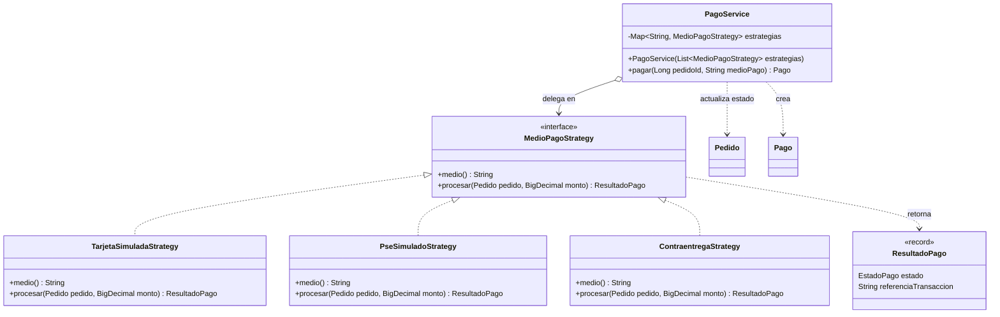

## Strategy (Comportamiento): medio de pago — HU-10 (Sprint 2)

### Problema de negocio

Un comprador debe poder pagar su pedido por distintos medios (tarjeta, PSE,
contraentrega) y cada medio tiene reglas de procesamiento distintas: en unos
el pago se aprueba o rechaza al instante, en otros queda pendiente hasta la
entrega. Además, en este sprint el procesamiento es **simulado** y más
adelante deberá reemplazarse por una pasarela real (Wompi, PayU, etc.).

Sin un patrón, `PagoService` acumularía una cadena de `if / else if` por medio
de pago: cada medio nuevo obligaría a modificar un método que ya funciona y
está probado, aumentando el riesgo de regresiones.

### Solución

Se define una interfaz `MedioPagoStrategy` con una implementación por medio de
pago. `PagoService` (el contexto) recibe todas las estrategias por inyección
de dependencias de Spring, las indexa por nombre de medio y delega el
procesamiento en la que corresponda al `medio_pago` solicitado. Agregar un
medio nuevo (o reemplazar el simulado por uno real) es crear una clase
`@Component` nueva, sin modificar `PagoService`.

- **Mecanismo Spring Boot:** `List<MedioPagoStrategy>` inyectada por
  constructor, convertida a `Map<String, MedioPagoStrategy>` + `@Component`.
- **Atributo ISO/IEC 25010:** Mantenibilidad (modificabilidad) y
  Adecuación funcional.
- **Principio:** abierto/cerrado (OCP).

### Diagrama de clases



### Participantes

| Rol | Clase |
|---|---|
| Strategy | `MedioPagoStrategy` |
| ConcreteStrategy | `TarjetaSimuladaStrategy`, `PseSimuladoStrategy`, `ContraentregaStrategy` |
| Context | `PagoService` |

### Implementación

```java
// service/pago/MedioPagoStrategy.java
public interface MedioPagoStrategy {
  String medio();
  ResultadoPago procesar(Pedido pedido, BigDecimal monto);
}

// service/pago/TarjetaSimuladaStrategy.java
@Component
public class TarjetaSimuladaStrategy implements MedioPagoStrategy {
  @Override
  public String medio() {
    return "TARJETA";
  }

  @Override
  public ResultadoPago procesar(Pedido pedido, BigDecimal monto) {
    // Simulado: aprueba salvo que el monto supere un tope de prueba
    boolean aprobado = monto.compareTo(TOPE_SIMULADO) <= 0;
    return new ResultadoPago(
        aprobado ? EstadoPago.COMPLETADO : EstadoPago.RECHAZADO,
        "SIM-" + UUID.randomUUID());
  }
}

// service/PagoService.java (Context)
@Service
public class PagoService {
  private final Map<String, MedioPagoStrategy> estrategias;

  public PagoService(List<MedioPagoStrategy> estrategias) {
    this.estrategias = estrategias.stream()
        .collect(Collectors.toMap(MedioPagoStrategy::medio, Function.identity()));
  }

  public Pago pagar(Pedido pedido, String medioPago) {
    MedioPagoStrategy estrategia = estrategias.get(medioPago);
    if (estrategia == null) {
      throw new MedioPagoNoSoportadoException(medioPago);
    }
    ResultadoPago resultado = estrategia.procesar(pedido, pedido.getTotal());
    // ... crear Pago con medio, referencia y estado; si COMPLETADO, Pedido -> CONFIRMADO
  }
}
```

### Relación con el backlog y pruebas

- **Tarea:** T10.7 (`PagoService`), HU-10 Pagos en Línea.
- **Pruebas (JUnit 5):** `PagoServiceTest` verifica que se elige la estrategia
  correcta según el medio, que un medio desconocido lanza
  `MedioPagoNoSoportadoException` (HTTP 400) y que un pago `RECHAZADO` deja el
  pedido en `PENDIENTE`.
- **Evolución:** al integrar una pasarela real, se agrega p. ej.
  `WompiStrategy implements MedioPagoStrategy` y se retira la simulada, sin
  cambios en `PagoService` ni en los controladores.
