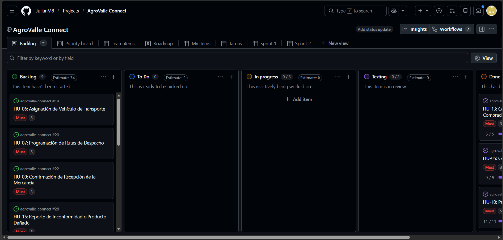
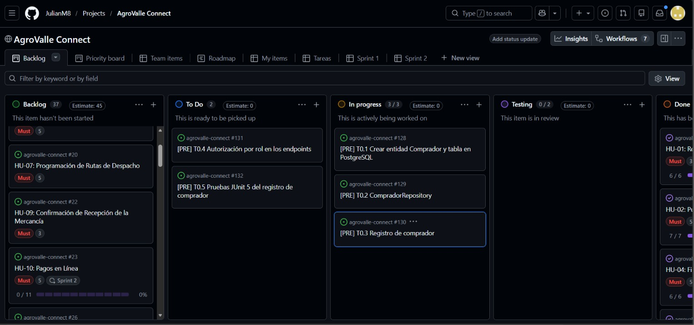
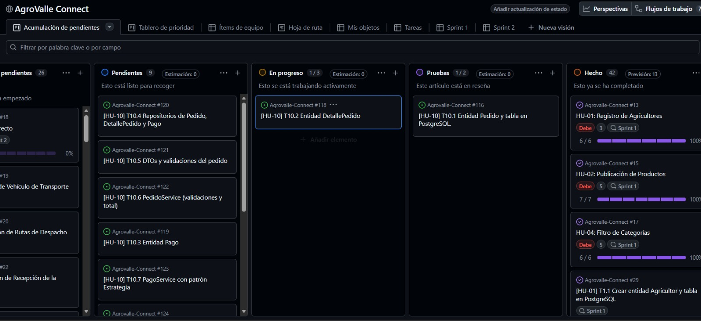
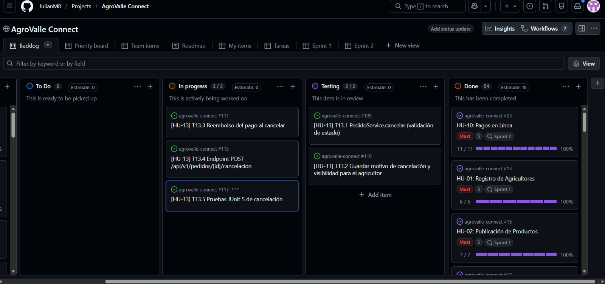
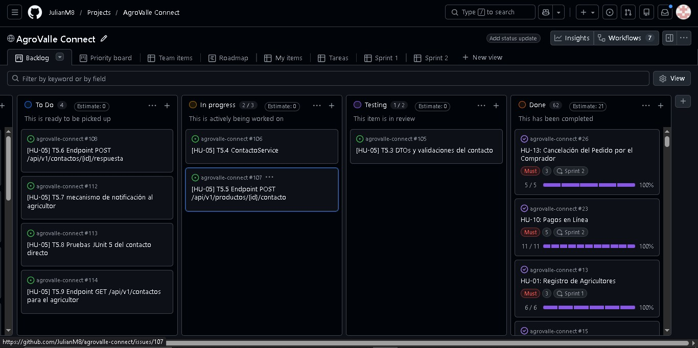
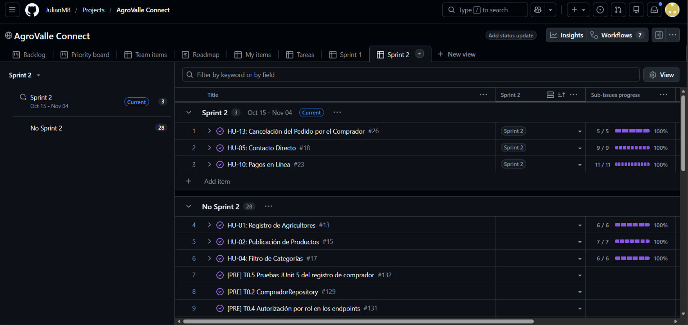
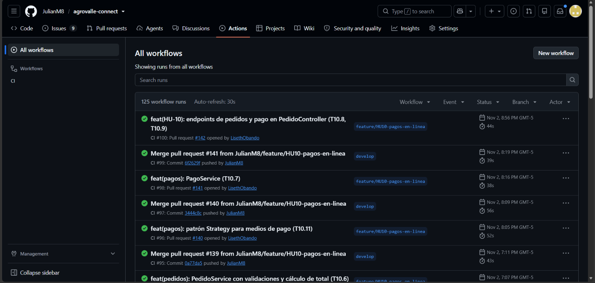

# Sprint Review — Sprint 2 — AgroValle Connect

**Fecha:** [4 de noviembre de 2026]
**Asistentes del equipo:** Julian Mina (Scrum Master), Josué Mindineros (Backend/DevOps), Lesly Quintero (Product Owner), Yenni Obando (QA/Documentador)

## 1. Sprint Goal

Habilitar el flujo de pedido y pago en línea entre comprador y
agricultor —base de todo lo que sigue en logística y seguimiento—,
junto con la posibilidad de cancelar un pedido antes de su despacho y
el contacto directo comprador–agricultor, validando la persistencia en
PostgreSQL y la arquitectura REST ya establecida en el Sprint 1, e
incorporando el patrón de diseño comportamental **Strategy** en el
procesamiento de pagos.

## 2. Historias comprometidas vs. completadas

| Historia | Estimación | Estado | Evidencia |
|---|---|---|---|
| Prerrequisitos: Registro de Comprador y Roles (T0.1 a T0.5) | Sin estimacion (se hizo como prerrequisito al implementar roles) |Completada| Endpoint `POST /api/v1/auth/register/comprador`, `@PreAuthorize("hasRole('AGRICULTOR')")` en `ProductoController.publicar`, pruebas `CompradorServiceTest` (5 casos), `CompradorControllerTest` (6 casos) y prueba 403 en `ProductoControllerTest` |
| HU-10: Pagos en Línea (T10.1 a T10.11) | 5 pts |Completada| Endpoints `POST /api/v1/pedidos`, `POST /api/v1/pedidos/{id}/pago` y `GET /api/v1/pedidos/{id}/pago`; patrón Strategy (`Tarjeta`, `PSE`, `Contraentrega`) |
| HU-13: Cancelación del Pedido (T13.1 a T13.5) | 3 pts |Completada| Endpoints `POST /api/v1/pedidos/{id}/cancelacion` y `GET /api/v1/pedidos`; pruebas de cancelación, reembolso, rol incorrecto y petición sin token |
| HU-05: Contacto Directo (T5.1 a T5.9) | 3 pts | Completada | Endpoints `POST /api/v1/productos/{id}/contacto`, `POST /api/v1/contactos/{id}/respuesta` y `GET /api/v1/contactos`; revisada y confirmada por un compañero |
| **Total** | **11 pts** | | |

## 3. Demostración funcional

Se realizará una demostración en Postman de las historias de usuario trabajadas en el Sprint 2.

**Video demostrativo:**
[Ver demostracion](https://drive.google.com/file/d/1Tg7-V0BabRxwoyTAeCXKPzxbArzFh0CE/view?usp=drive_link)

**Registro de comprador y roles**

1. **Registrar comprador válido** → `POST /api/v1/auth/register/comprador` → cuenta creada con rol `COMPRADOR` en `usuarios` y registro asociado en `compradores` (respuesta **201 Created** [confirmar]).
2. **Registrar con una identificación que ya existe como Usuario y la contraseña correcta** → se reutiliza la cuenta y se le agrega el rol `COMPRADOR`.
3. **Registrar con una identificación existente y contraseña incorrecta** → respuesta **401 Unauthorized**, sin revelar si la identificación ya es comprador o agricultor.
4. **Registrar con datos inválidos** (identificación distinta de 10 dígitos, correo inválido, contraseña menor a 8 caracteres, latitud o longitud fuera de rango) → respuesta **400 Bad Request**.
5. **Publicar un producto con un usuario sin rol `AGRICULTOR`** → respuesta **403 Forbidden**, aunque tenga otros roles.

**HU-10 — Pagos en línea**

6. **Crear un pedido válido** → `POST /api/v1/pedidos` → pedido con su detalle y total calculado, validando producto, cantidad disponible y un solo agricultor por carrito.
7. **Registrar el pago por tarjeta, PSE o contraentrega** → `POST /api/v1/pedidos/{id}/pago` → pago registrado según el medio elegido.
8. **Consultar el pago de un pedido** → `GET /api/v1/pedidos/{id}/pago`.

**HU-13 — Cancelación del pedido**

9. **Cancelar un pedido en estado PENDIENTE o CONFIRMADO con motivo** → `POST /api/v1/pedidos/{id}/cancelacion` → respuesta **200 OK**, estado `CANCELADO` y motivo guardado.
10. **Cancelar un pedido con pago COMPLETADO** → el pago pasa a `REEMBOLSADO`.
11. **Cancelar un pedido en EN_TRANSPORTE, ENTREGADO o ya CANCELADO, o con motivo vacío** → respuesta **400 Bad Request**.
12. **Cancelar un pedido de otro comprador o inexistente** → respuesta **404 Not Found**.
13. **Cancelar sin rol `COMPRADOR` o sin token** → rechazo de la petición.
14. **El agricultor consulta sus pedidos** → `GET /api/v1/pedidos` → lista con estado y motivo de cancelación.

**HU-05 — Contacto directo**

15. **Comprador envía una solicitud de contacto sobre un producto** → `POST /api/v1/productos/{id}/contacto` → respuesta **201 Created**.
16. **Contacto sobre un producto inexistente** → respuesta **404 Not Found**.
17. **El agricultor dueño del producto responde la solicitud** → `POST /api/v1/contactos/{id}/respuesta` → respuesta **200 OK**.
18. **El agricultor consulta sus solicitudes** → `GET /api/v1/contactos` y `GET /api/v1/contactos?pendientes=true`, mostrando solo las de sus propios productos.

## 4. Evidencia técnica (calidad)

- **Pipeline de CI (GitHub Actions, `ci.yml`):** ejecuta `./mvnw -B verify` en cada Pull Request hacia `develop`. Durante el sprint falló una vez por compilación (clases `PedidoResponse`, `PagoResponse` y `MedioPagoStrategy` con firmas distintas entre la máquina local y GitHub) y otra por cobertura insuficiente en HU-10, al no estar aún las pruebas de pedido y pago.
- **Checkstyle y Husky:** detectaron problemas antes de integrar código en `develop`. En HU-05 la última corrida de T5.9 terminó con 0 errores de Checkstyle.
- **Cobertura (JaCoCo):** mínimo de 60 % exigido. La última corrida local de HU-05 (T5.9) terminó con `BUILD SUCCESS`, 74 pruebas aprobadas y cobertura aprobada.
- **Pruebas nuevas:** servicio y controlador con JUnit 5 y MockMvc en comprador, pedido, pago, cancelación y contacto, incluyendo casos de 400, 401, 403 y 404.
- **Seguridad:** se activó `@EnableMethodSecurity` en `SecurityConfig`. Al implementar el registro de comprador se detectó que `AgricultorService` no validaba la contraseña al reutilizar una cuenta existente, lo que permitía agregar un rol a la cuenta de otra persona conociendo solo su identificación. Se corrigió en un commit separado (`fix`) y se ajustaron sus pruebas.
- **Protección de rama:** `develop` sigue exigiendo que el check `build` de GitHub Actions pase antes de fusionar cualquier Pull Request.

## 5. Trabajo no completado y su destino

| Elemento | Motivo | Destino |
|---|---|---|
| Notificaciones por correo o push al registrar un contacto (T5.7) | No se implementó; el agricultor consulta las solicitudes dentro de la aplicación y se publica `ContactoRegistradoEvent` | Candidato para un sprint futuro|

## 6. Enlaces de referencia

- Repositorio: `github.com/JulianM8/agrovalle-connect`
- Tablero Kanban: proyecto "AgroValle Connect" (GitHub Projects), vista "Sprint 2"
- Sprint Backlog: `BACKLOG.md`
- Planificación técnica: `docs/sprint-2-planning.md`

**Video del tablero kanban demostrando el cierre de todas las tareas comprometidas y las ramas creadas:**
[Ver demostracion](https://drive.google.com/file/d/1bHjR8FMBtlb0WUvxBdS4tJFZuYxgvqOh/view?usp=sharing)

## Algunas capturas de pantalla del flujo en tablero kanban

**Tablero General**

**Flujo en Prerrequisitos (Comprador y Roles)**

**Flujo en HU-10**

**Flujo en HU-13**

**Flujo en HU-05**

**Evidencia de historias de usuarios terminadas con sus tareas**

## Integracion continua CI

En esta parte de la integracion continua se evidencia la ejecucion de las pruebas unitarias y de integracion en GitHub Actions, asi como la cobertura de codigo y el checkstyle, nosotros lo implementamos en el archivo `ci.yml` y se ejecuta en cada Pull Request hacia la rama `develop` y rama `main`, esto nos permite tener un control de calidad del codigo y evitar que se integren cambios que rompan la aplicacion.

Nosotros decidimos implememtar la integracion continua a finales del sprint 1 por medio de la documentacion que se nos fue proporcionada que hablaba sobre las proximas entregas y como implementar ciertas cosas, a continuacion se muestra la evidencia de la integracion continua en GitHub Actions mostrando el build en verde y algunos tambien en rojo.

**Evidencia de la integracion continua en GitHub Actions**

**Video mostrando algunos builds que fueron ejecutados:**
[Ver demostracion](https://drive.google.com/file/d/1Zk_CC0sL4RgNMnwPm5_6IEeqdCiztj0Z/view?usp=drive_link)

