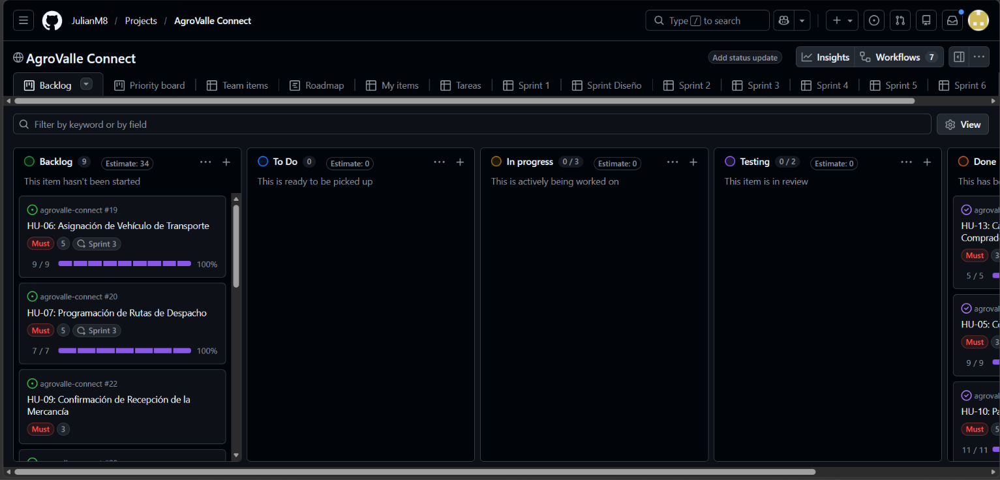
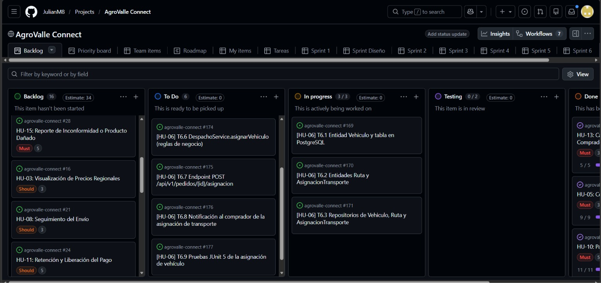
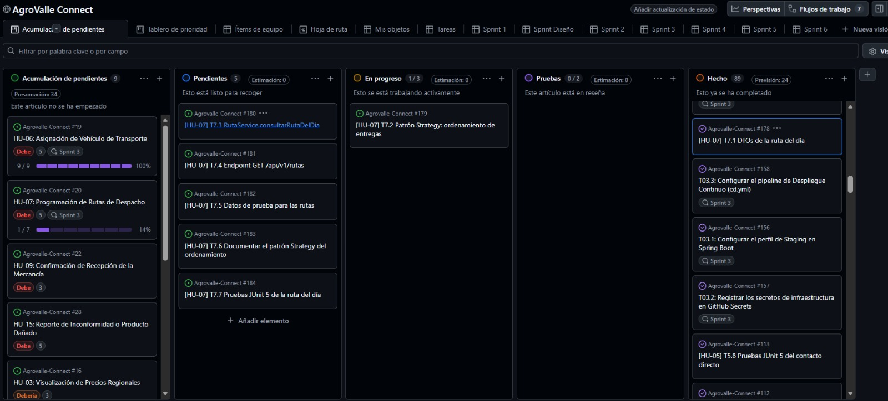
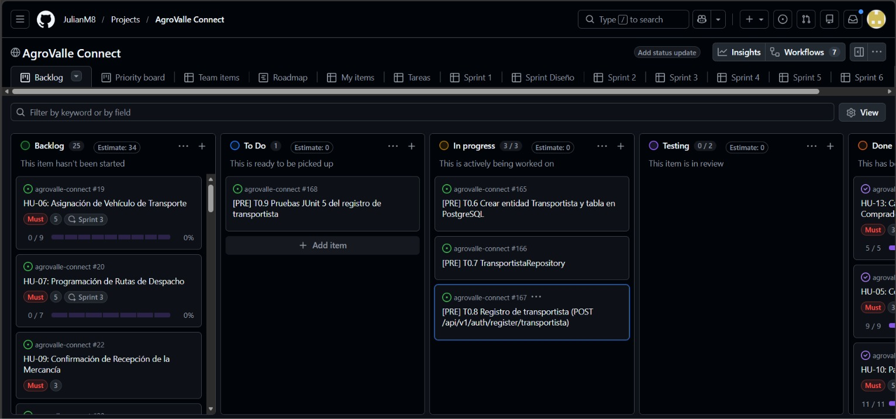
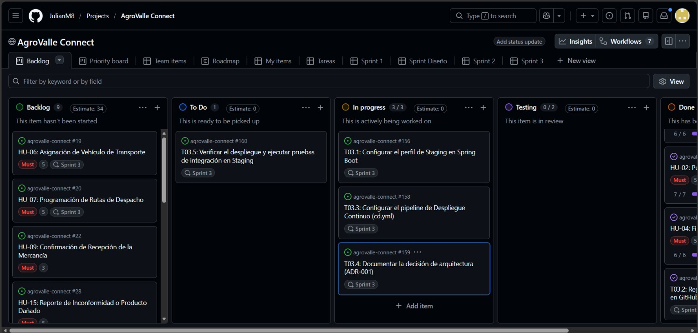
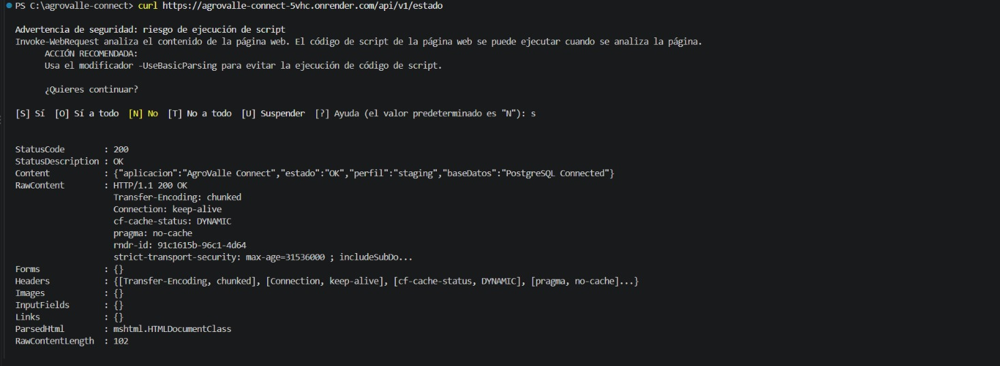
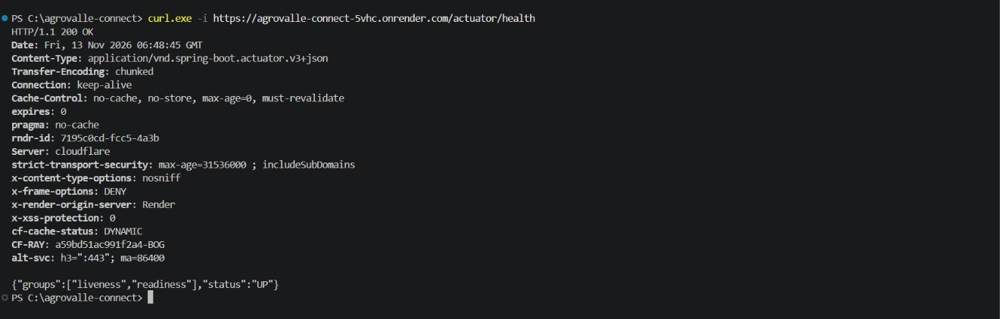

# Sprint Review — Sprint 3 — AgroValle Connect

**Fecha:** [19 de noviembre de 2026]
**Asistentes del equipo:** Julian Mina (Scrum Master), Josué Mindineros (Backend/DevOps), Lesly Quintero (Product Owner), Yenni Obando (QA/Documentador)

## 1. Sprint Goal

Habilitar el despacho de los pedidos confirmados: que el agricultor pueda asignar un vehículo de transporte a un pedido (notificando al comprador) y que el transportista consulte la secuencia sugerida de entregas del día, ordenada según la ubicación de cada comprador, aplicando el patrón comportamental Strategy para el ordenamiento.

Además, automatizar el despliegue continuo (CD) de AgroValle Connect hacia un ambiente de Staging en la nube: cada integración verificada en la rama `main` publica la aplicación Spring Boot en una URL pública conectada a una base de datos PostgreSQL de preproducción, con las credenciales protegidas en GitHub Secrets y la decisión de arquitectura documentada en un ADR.

## 2. Historias comprometidas vs. completadas

| Historia / bloque | Estimación | Estado | Evidencia |
|---|---|---|---|
| HU-06: Asignación de Vehículo de Transporte | 5 pts | Completada [PENDIENTE: confirmar fusión del PR a `develop`] | Endpoints `POST /api/v1/vehiculos`, `GET /api/v1/vehiculos?tipoTransporte=`, `POST /api/v1/pedidos/{id}/asignacion` y `GET /api/v1/pedidos/{id}/transporte`; pruebas `VehiculoControllerTest`, `VehiculoServiceTest`, `DespachoControllerTest` y `DespachoServiceTest` |
| HU-07: Programación de Rutas de Despacho | 5 pts | Completada [PENDIENTE: confirmar fusión del PR a `develop`] | Endpoint `GET /api/v1/rutas?fecha=&criterio=`, patrón Strategy documentado en `docs/diseno/patrones.md`; pruebas `RutaControllerTest` y `RutaServiceTest` |
| Prerrequisitos Transportista (T0.6 a T0.9) | Tarea técnica, sin puntos | Completada [PENDIENTE: confirmar fusión del PR] | Entidad `Transportista`, `POST /api/v1/auth/register/transportista`, pruebas `TransportistaServiceTest` y `TransportistaControllerTest` |
| Infraestructura: Despliegue Continuo a Staging (T03.1 a T03.5) | Tarea técnica, sin puntos | Ver detalle en la sección 2.3 | `application-staging.yml`, `cd.yml`, ADR-001, Staging en Render |
| **Total comprometido** | **10 pts** (más las tareas técnicas) | | |

Trabajo de soporte realizado:

| Actividad | Resultado |
|---|---|
| Base de datos de Staging en Neon | Base `agrovalle_staging` creada|
| Empaquetado con Docker | `Dockerfile` multietapa (JDK 17 / JRE 17) y `.dockerignore`, requeridos por Render para ejecutar Java |
| Servicio web en Render | Servicio en estado **Live**, conectado a Neon (`HikariPool-1 - Start completed`) |
| Endpoint `GET /api/v1/estado` y `SecurityConfig` | `EstadoController`, `EstadoControllerTest` y acceso público a ese endpoint y a `/actuator/health` |

## 3. Demostración funcional

Se realiza la demostración en Postman de las historias del sprint y del ambiente de Staging publicado en la nube.

**Video demostrativo:**
[Ver demostración](https://drive.google.com/file/d/13YJOMSyvtb9fZ0GAEiYAbXPOP9Bau5ko/view?usp=sharing)

[Ver demostración](https://drive.google.com/file/d/1BbighUIBDScvQTbr2WPbqlJwWk3BiVJM/view?usp=sharing)

**HU-06: Asignación de vehículo**

1. **Registrar transportista** → `POST /api/v1/auth/register/transportista` → **201 Created**; con una identificación ya registrada y contraseña incorrecta → **401**; con identificación o correo duplicado → **409**.
2. **Registrar vehículo** (token de transportista) → `POST /api/v1/vehiculos` → **201 Created**; con placa duplicada → **409 Conflict**; con capacidad negativa → **400 Bad Request**.
3. **Listar vehículos por tipo** (token de agricultor) → `GET /api/v1/vehiculos?tipoTransporte=CAMION` → **200 OK** con los vehículos; sin coincidencias, mensaje claro.
4. **Asignar vehículo a un pedido confirmado** → `POST /api/v1/pedidos/{id}/asignacion` → **201 Created**, el pedido pasa a `EN_TRANSPORTE`.
5. **Asignar a un pedido no confirmado** → **400**; **de otro agricultor** → **404**; **ya asignado** → **409**.
6. **El comprador consulta el transporte** (token de comprador) → `GET /api/v1/pedidos/{id}/transporte` → **200 OK** con tipo de transporte y placa.

**HU-07: Rutas de despacho**

7. **Ruta del día** (token de transportista) → `GET /api/v1/rutas?fecha=AAAA-MM-DD` → **200 OK** con las paradas en el orden sugerido (por defecto, vecino más cercano).
8. **Cambiar el criterio** → `GET /api/v1/rutas?criterio=municipio` → **200 OK** con las paradas agrupadas por municipio, en orden distinto al anterior.
9. **Criterio inválido** → **400**; **sin ruta para la fecha** → **404**; **token sin rol TRANSPORTISTA** → **403**.

**Despliegue continuo a Staging**

10. **Perfil de Staging activo** (T03.1) → logs de Render: `The following 1 profile is active: "staging"`.
11. **Secretos protegidos** (T03.2) → GitHub, Settings → Secrets and variables → Actions, sin exponer valores.
12. **Pipeline en verde** (T03.3) → push/merge a `main`: los jobs `verify-and-test` y `deploy-to-staging` terminan exitosos.
13. **Despliegue disparado por el pipeline** (T03.3) → Render, pestaña Events.
14. **ADR publicado** (T03.4) → `ADR-001-despliegue-staging-paas.md` en `docs/architecture-decisions/`.
15. **Verificación de salud** (T03.5) → `GET /api/v1/estado` → **200 OK**:
    ```json
    {
      "aplicacion": "AgroValle Connect",
      "estado": "OK",
      "perfil": "staging",
      "baseDatos": "PostgreSQL Connected"
    }
    ```
16. **Escritura en la base remota** (T03.5) → `POST /api/v1/auth/register` → **201 Created**, con el agricultor guardado en la tabla `agricultores` de Neon.


## 4. Evidencia técnica (calidad)

- **Pipeline de CI (`ci.yml`):** ejecuta `./mvnw -B clean verify` en cada Pull Request hacia `develop` y `main` (compilación, Checkstyle, pruebas y JaCoCo).
- **Pipeline de CD (`cd.yml`):** se ejecuta en cada push a `main`. `verify-and-test` corre `./mvnw -B clean verify` y `deploy-to-staging`, condicionado con `needs: verify-and-test`, invoca el Deploy Hook de Render. 
- **Checkstyle:** 0 violaciones en la última ejecución exitosa
- **Cobertura (JaCoCo):** por encima del mínimo de 60 % requerido, alcanzado incorporando pruebas de servicio
- **Patrones de diseño:** Strategy para el ordenamiento de entregas (`OrdenEntregaStrategy`) y Observer para la notificación de la asignación (`AsignacionRegistradaEvent`), además del Strategy de medios de pago del Sprint 2.
- **Gestión de secretos:** las credenciales viven en GitHub Secrets y en las variables de entorno de Render; ninguna se versiona.
- **Protección de ramas:** `develop` y `main` exigen Pull Request y CI en verde.

## 5. Enlaces de referencia

- Repositorio: `github.com/JulianM8/agrovalle-connect`
- Tablero Kanban: proyecto "AgroValle Connect" (GitHub Projects), vista "Sprint 3"
- Sprint Backlog: `product_backlog_bdd.md` en `docs/requirements/`
- Planificación técnica: `docs/sprints/sprint-3/planning.md`
- Decisión de arquitectura: `docs/architecture-decisions/ADR-001-despliegue-staging-paas.md`
- Patrones de diseño: `docs/diseno/patrones.md`
- Esquema de base de datos: `src/main/resources/db/migration/schema.sql`


## Algunas capturas de pantalla del flujo en tablero kanban

**Tablero General**



**Flujo en HU-06**




**Flujo en HU-07**



**Flujo en los prerrequisitos del Transportista**



**Flujo en el Despliegue Continuo (T03.1 a T03.5)**




**Respuesta HTTP 200 OK de `/api/v1/estado` y registro en Staging con su fila en Neon**



