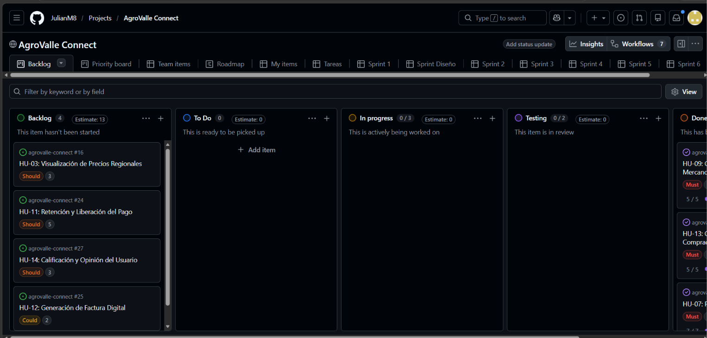
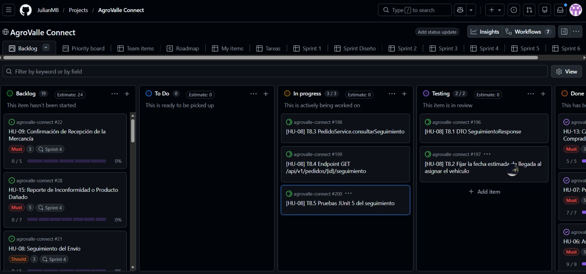
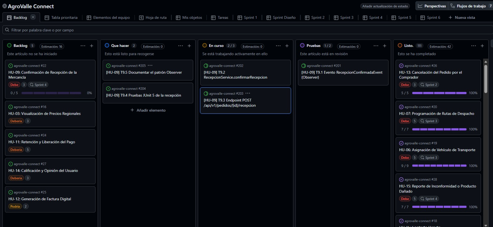
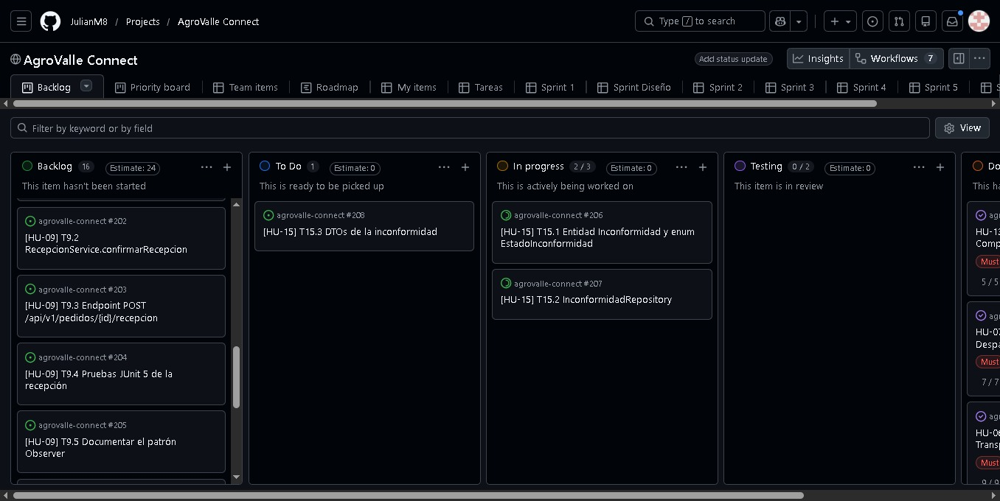

# Sprint Review — Sprint 4 — AgroValle Connect

**Fecha:** [25 de noviembre de 2026]
**Asistentes del equipo:** Julian Mina (Scrum Master), Josué Mindineros (Backend/DevOps), Lesly Quintero (Product Owner), Yenni Obando (QA/Documentador)

## 1. Sprint Goal

Cerrar el ciclo del pedido después del despacho: que el comprador consulte el estado actualizado de su pedido y su fecha estimada de llegada, pueda reportar una inconformidad con evidencia si el producto no cumple lo acordado, y confirme la recepción de la mercancía, dejando el pedido en estado `ENTREGADO` y publicando el evento que habilita la liberación del pago al agricultor (HU-11, Sprint 5).

## 2. Historias comprometidas vs. completadas

| Historia | Estimación | Responsables | Estado | Evidencia |
|---|---|---|---|---|
| HU-08: Seguimiento del envío | 3 pts | Julian y Lesly | Completada | Endpoint `GET /api/v1/pedidos/{id}/seguimiento`, pruebas en `PedidoServiceTest`, `PedidoControllerTest` y `DespachoServiceTest` |
| HU-09: Confirmación de recepción | 3 pts | Yenni | Completada | Endpoint `POST /api/v1/pedidos/{id}/recepcion`, pruebas `RecepcionServiceTest` y `RecepcionControllerTest` |
| HU-15: Reporte de inconformidad | 5 pts | Josué | Completada | Endpoints `POST` y `GET` de inconformidades del pedido, pruebas de servicio, controlador e integración |
| **Total** | **11 pts** | | | |

## 3. Demostración funcional

Se realizará una demostración en Postman de las historias de usuario trabajadas en el Sprint 4.

**Video demostrativo:** [Ver demostración]() 

**HU-08 — Seguimiento del envío**

1. **Consultar el seguimiento de un pedido asignado** → `GET /api/v1/pedidos/{id}/seguimiento` con el token del comprador → **200 OK**, con el estado `EN_TRANSPORTE` y la fecha estimada de llegada tomada de la fecha de la ruta.
2. **Consultar un pedido sin fecha estimada** (por ejemplo, uno asignado antes del cambio) → **200 OK**, con el mensaje "Aún no hay fecha estimada de llegada".
3. **Consultar un pedido de otro comprador o inexistente** → **404 Not Found**.
4. **Consultar sin el rol COMPRADOR** → **403 Forbidden**.

**HU-15 — Reporte de inconformidad**

5. **Registrar una inconformidad sobre un pedido propio** → `POST` con descripción y evidencia → **201 Created**, con la inconformidad guardada en estado `EN_REVISION`.
6. **Consultar las inconformidades del pedido** → `GET` → **200 OK**, con la inconformidad registrada.
7. **Reportar sobre un pedido ajeno o inexistente** → **404 Not Found**.
8. **Reportar con datos inválidos** → **400 Bad Request**.
9. Al registrarla se publica `InconformidadRegistradaEvent` (patrón Observer) y los datos del pago se conservan.

**HU-09 — Confirmación de recepción**

10. **Confirmar la recepción de un pedido `EN_TRANSPORTE`** → `POST /api/v1/pedidos/{id}/recepcion` → **200 OK**, con el pedido en `ENTREGADO` y su `fecha_entrega`.
11. **Confirmar un pedido que ya está entregado** → **409 Conflict**.
12. **Confirmar un pedido que no está `EN_TRANSPORTE`** → **400 Bad Request**.
13. **Confirmar con una inconformidad en revisión** → **409 Conflict**.
14. **Confirmar un pedido ajeno** → **404 Not Found**.
15. Tras el commit se publica `RecepcionConfirmadaEvent` y el listener deja la traza en el log. Se usa bloqueo pesimista para evitar confirmaciones concurrentes.

## 4. Evidencia técnica (calidad)

- **Pipeline de CI (GitHub Actions, `ci.yml`):** el PR #221 de HU-15 pasó en verde. Antes fallaron dos ejecuciones del PR #217 porque `ProductoRepositoryTest` dependía del orden de ejecución: `PagoConcurrenciaTest` corría primero y dejaba dos Aguacates en la misma H2, así que el filtro por Palmira y Frutas devolvía tres. Se resolvió en el PR #218 con una base H2 propia para la prueba de concurrencia.
- **Checkstyle:** violaciones de `EmptyLineSeparator` en HU-15 y HU-09 (línea en blanco entre campos), corregidas antes de integrar.
- **Cobertura (JaCoCo):** `./mvnw verify` pasa con el mínimo de 60 %. 
- **Protección de rama:** `develop` exige que el check `build` pase antes de fusionar.

## 5. Enlaces de referencia

- Repositorio: `github.com/JulianM8/agrovalle-connect`
- Tablero Kanban: proyecto "AgroValle Connect" (GitHub Projects), vista "Sprint 4"
- Planificación del sprint: `docs/sprint-4-planning.md` 
- Sprint Backlog: `product_backlog_bdd.md` en `docs/requirements/`
- Planificación técnica: `docs/sprints/sprint-4/planning.md`

**Video del tablero Kanban demostrando el cierre de las tareas comprometidas y las ramas creadas:**
[Ver demostración](https://drive.google.com/file/d/1mHkNGOjecuqQpOtiagtCBp3GxZGF1Nyy/view?usp=sharing)

## Algunas capturas de pantalla del flujo en tablero Kanban

**Tablero General**

**Flujo en HU-08**

**Flujo en HU-09**

**Flujo en HU-15**

